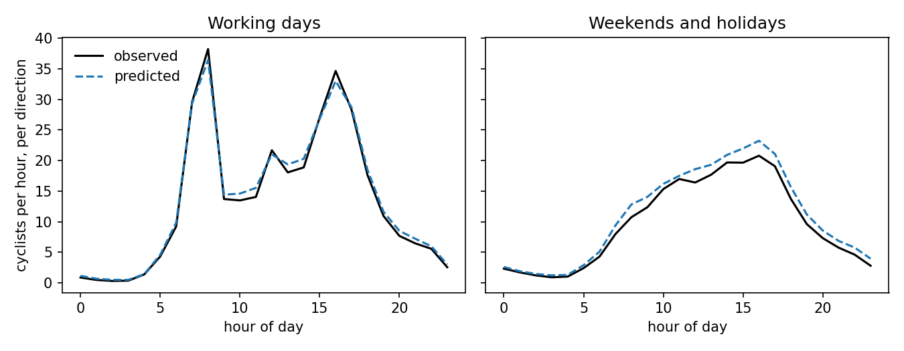

# flanders-cycling-forecast

Hourly cyclist counts at the Flemish road agency's counting stations, predicted one day ahead from weather, calendar and location.

This is my part of a group project for Modern Data Analytics at KU Leuven (spring 2026, Group 10). The project topic was the effect of external events on cycling traffic in Flanders. I built the data panel and the predictive model. My teammates did the station clustering, the SHAP analysis, the event-impact analysis and the dashboards, and that work is not in this repo. The submitted group repo is [MDA-Project-Group10](https://github.com/pihaoking/MDA-Project-Group10).

## Data

- Counts: [AWV fietstellingen open data](https://opendata.apps.mow.vlaanderen.be/fietstellingen/index.html), 15-minute counts per station and direction, August 2019 to December 2025.
- Weather: hourly observations for five regions, from the Visual Crossing API.
- Belgian public holidays and Flemish school holidays.
- Road bearing per station, from OpenStreetMap.

None of it is in the repo. `data/` is ignored.

## Pipeline

| File | What it does |
|---|---|
| `src/01_build_event_features.py` | holiday calendars to one row per day |
| `src/02_build_panel.py` | aggregates counts to hourly, attaches the nearest weather region, holidays and road bearing. 9.8 million rows, 150 stations |
| `src/split.py` | train 2023, validation 2024, test 2025 |
| `src/cache_predictions.py` | fits the random forest and saves predictions for all three splits |
| `src/model_diagnostics.py` | random forest against XGBoost: 5-fold CV, per-segment RMSE, residuals |
| `src/plot_hourly_profile.py` | the figure below |

2019 to 2022 is dropped because most stations were installed during 2022. Stations that first appear after 2023 are removed from validation and test.

One feature I added is `wind_impact`, the cosine of the angle between wind direction and the road bearing for that counting direction, so a headwind and a tailwind get opposite signs.

## Model and results

Random forest, 100 trees, depth 20, each tree on 30% of the rows. 21 features: station id and coordinates, hour, weekday, month, a holiday flag, days to the nearest holiday, direction, nine weather variables, road bearing, wind impact, and the count at the same station and hour one day earlier.

| | Rows | R2 | MAE | RMSE |
|---|---|---|---|---|
| Train 2023 | 2,397,410 | 0.883 | 3.38 | 8.42 |
| Validation 2024 | 2,416,668 | 0.708 | 4.54 | 14.72 |
| Test 2025 | 2,395,134 | 0.778 | 4.89 | 13.06 |

For comparison on the 2025 test set:

| Model | R2 | MAE |
|---|---|---|
| Yesterday's count at the same hour, no model | 0.613 | 5.69 |
| Random forest without the lag feature | 0.649 | 5.62 |
| Random forest with the lag feature | 0.778 | 4.89 |

The mean count in the test set is 11.7 cyclists per hour per direction, so an MAE of 4.9 is still large in relative terms.



The model follows the two commuting peaks on working days and overpredicts by up to about 2.4 cyclists per hour on weekends and holidays.

## Limits

- With the lag feature this is a one-day-ahead forecast. It cannot be used for longer horizons.
- A missing lag value is filled with 0, which is wrong for stations that were offline the day before.
- Station id is passed in as a number, so the model cannot predict for a new station.
- Test R2 is higher than validation R2. I did not find out why. One year per split is a single draw, not a cross-validation.
- Hyperparameters were picked from four configurations, not a full search.

## Running it

Python 3.12.

```
pip install -r requirements.txt
python src/01_build_event_features.py
python src/02_build_panel.py
python src/cache_predictions.py
python src/plot_hourly_profile.py
```

The raw files have to be in `data/` first. Building the panel takes about three minutes and fitting the forest about three more.
